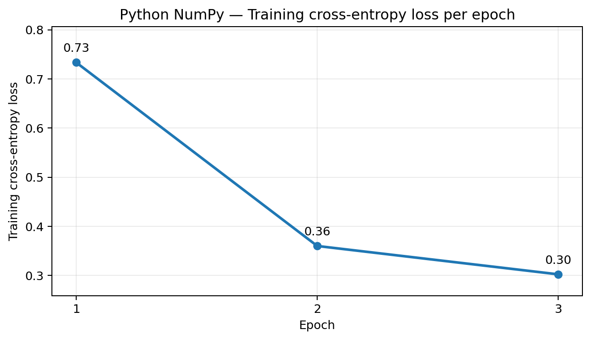
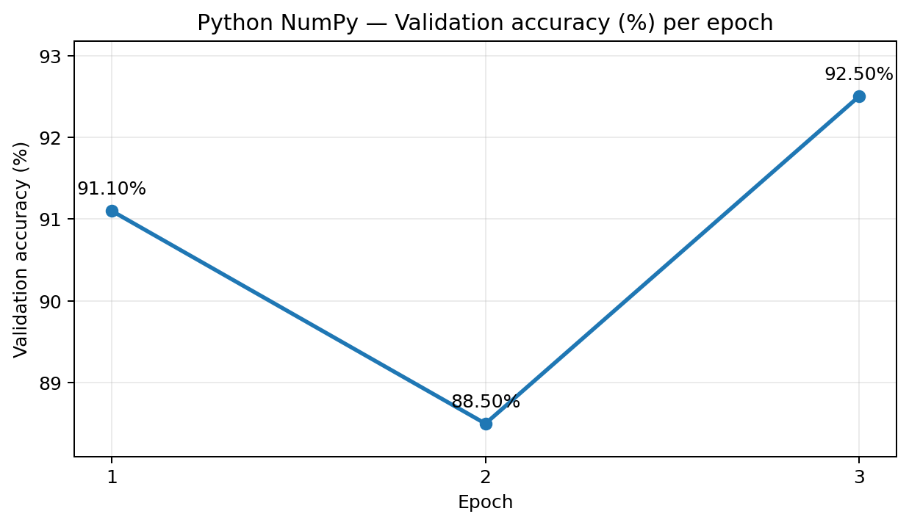
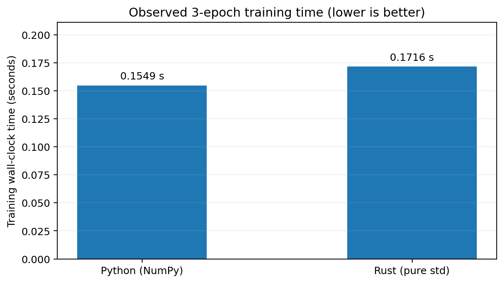
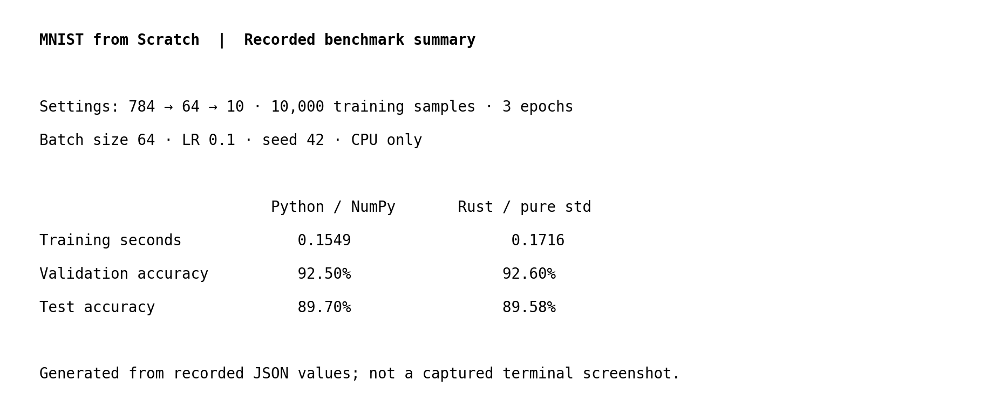

# MNIST Neural Network From Scratch — Python vs. Rust

A reproducible learning experiment: implement and train the **same 784 → 64 → 10 multilayer perceptron (MLP)** in Python and Rust, with **hand-written forward propagation, backpropagation, cross-entropy loss, and mini-batch stochastic gradient descent (SGD)**. The goal is to understand how neural networks work and compare two implementations—not to claim the best MNIST benchmark.

- **Python:** NumPy for vectorized array operations; **no PyTorch, TensorFlow, Keras, JAX, or autograd**.
- **Rust:** Rust standard library only; explicit row-major weights, gradient accumulation, random-number generation, and IDX parsing. **No third-party crates** in the baseline.
- **Dataset:** MNIST, with 60,000 training images and 10,000 test images. Each image is 28 × 28 grayscale pixels, classified into one of 10 digits (0–9).
- **Evaluation:** A training subset (10,000 images in the reported runs), held-out validation images from the original training split (1,000 in the reported runs), and the untouched official test set (10,000 images).
- **Results:** The figures below come from recorded Python and Rust runs in `results/python.json` and `results/rust.json`, rather than made-up benchmarks.

## Architecture

```text
28 × 28 image → Flatten (784) → Dense (64) → ReLU → Dense (10)
                                                       ↓
                                                    Softmax
                                                       ↓
                                              Cross-entropy loss
                                                       ↓
                                                Mini-batch SGD
```

Backpropagation uses these operations (with batch size `B` and hidden size `H = 64`):

```text
Z1 = X @ W1 + b1                       W1: [784, H]
A1 = ReLU(Z1)                          W2: [H, 10]
Z2 = A1 @ W2 + b2
P  = softmax(Z2)
L  = -mean(log(P[range(B), labels]))

D2  = (P - one_hot(labels)) / B
 dW2 = A1.T @ D2
 db2 = sum(D2, axis=0)
D1  = (D2 @ W2.T) * (Z1 > 0)
 dW1 = X.T @ D1
 db1 = sum(D1, axis=0)
W   = W - learning_rate * dW
```

## Requirements

- Python 3.10+
- NumPy 2.x
- Rust stable (**1.85+** for Edition 2024) and Cargo

## Get started

Run these commands from the repository root in **Windows PowerShell**:

```powershell
py -3.12 -m venv .venv
.\.venv\Scripts\Activate.ps1
python -m pip install -r requirements.txt
python download_mnist.py
python -m unittest discover -s tests -v
python -m mnist_numpy.train --samples 10000 --epochs 3
cargo test --manifest-path rust/Cargo.toml
cargo run --release --manifest-path rust/Cargo.toml -- --samples 10000 --epochs 3
python experiments/compare.py
```

> Run `cargo` with `--release` for a meaningful optimized-build comparison. On Windows, the MSVC toolchain also requires the Visual C++ Build Tools/linker.

## Experiment configuration

Both runs reported the following settings:

| Setting | Value |
|---|---:|
| Training samples | 10,000 |
| Validation samples | 1,000 |
| Hidden neurons | 64 |
| Epochs | 3 |
| Batch size | 64 |
| Learning rate | 0.1 |
| Random seed | 42 |
| Input features | 784 |
| Output classes | 10 |

## Observed results

These are **actual recorded run results**, not estimates:

| Implementation | Training time (s) | Validation accuracy | Test accuracy |
|---|---:|---:|---:|
| **Python — NumPy vectorized (CPU)** | **0.1549** | 92.50% | **89.70%** |
| **Rust — pure standard library (CPU)** | 0.1716 | **92.60%** | 89.58% |

In these recorded runs, the NumPy implementation took **0.0167 seconds less** training time (about **9.7% less** than Rust). The validation accuracies differed by **0.10 percentage points** in Rust's favor; the test accuracies differed by **0.12 percentage points** in Python's favor. These differences are small, and a single run is not sufficient to establish a general performance advantage.

**Raw results:** [`results/python.json`](results/python.json) · [`results/rust.json`](results/rust.json)

### Training loss per epoch



### Validation accuracy per epoch



### Training time comparison



### Validation and test accuracy comparison


### Run screenshot



### Error analysis — next step

A **confusion matrix** and a **gallery of misclassified test images** are not included yet. Creating these correctly requires per-image true labels and predictions from the trained model; the aggregate accuracy values in the JSON files are not sufficient. After exporting actual predictions, save the resulting figures as `results/confusion_matrix.png` and `results/sample_errors.png`, then link them here.

## What I learned

Building the same neural network from scratch in Python and Rust helped me understand **forward propagation, backpropagation, cross-entropy loss, softmax, ReLU, and gradient descent** at a much deeper level. I learned why the combined softmax and cross-entropy gradient simplifies to `P - Y`, how ReLU blocks gradients for inactive neurons, and how matrix shapes and memory layout affect the implementation. An interesting outcome was that vectorized NumPy trained faster (**0.1549s**) than my dependency-free Rust version (**0.1716s**) in these runs, showing that **optimized numerical operations matter more than whether a language is compiled**. Rust also taught me more about ownership, contiguous data storage, and implementing low-level numerical routines manually. Finally, recording accuracy and timings reinforced why experiments need reproducible settings and careful interpretation rather than assumptions about performance.

## Future experiment: optimizing Rust

The current Rust baseline intentionally uses **only the standard library**. In a **separate experiment**, I could compare it with:

- **SIMD:** vectorized arithmetic to accelerate dot products and gradient calculations.
- **Rayon:** parallelize suitable matrix and batch operations across CPU cores.
- **Matrix libraries:** use optimized linear algebra (and potentially BLAS-backed routines) instead of handwritten loops.

Each version should use the same data split, hyperparameters, build mode, and timing scope, with repeated benchmark runs to evaluate both **speed and accuracy**. These optimization experiments are **future work**, not part of the results above.

## Reproducibility notes

- The timing values are the `train_seconds` fields from the recorded runs; they should **not** be interpreted as end-to-end time including download, setup, or evaluation without checking the corresponding code.
- Results can vary with CPU hardware, NumPy/BLAS setup, Rust compiler flags, and run-to-run variability.
- The architecture and training configuration are matched, but identical seeds across languages do **not necessarily** imply identical initial weights or sample shuffles because random-number generators may differ.
- The untouched official test set should be used for final evaluation, rather than for selecting hyperparameters.
